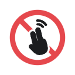

  

# Gesture Blocker

A Chrome extension that stops accidental trackpad swipes and pinch-zooms on the websites you choose — so a stray two-finger swipe doesn't throw you back a page, and a pinch doesn't zoom the whole site.

Handy for web apps where you scroll or pan a lot, like Figma, Google Sheets, Miro, or maps.

## Features

- **Block swipe back/forward** — two-finger horizontal swipes no longer navigate history. Horizontal scrolling *inside* the page (carousels, wide tables, canvases) still works.
- **Block pinch-to-zoom** — trackpad pinch no longer zooms the page.
- **Per-site control** — turn each one on or off for any site. A rule for `example.com` also covers its subdomains (`app.example.com`).
- **Status at a glance** — the toolbar icon turns red on sites where blocking is on, grey everywhere else.
- Settings sync across your Chrome profiles.

## Install

The extension isn't on the Chrome Web Store, so you load it yourself:

1. Download this repo — either `git clone` it, or click **Code → Download ZIP** and unzip it.
2. Open `chrome://extensions` in Chrome.
3. Turn on **Developer mode** (top-right).
4. Click **Load unpacked** and select the `gesture-blocker` folder.
5. Pin the extension to your toolbar (puzzle icon → pin).

Keep the folder where it is — Chrome loads the extension from it.

## Usage

1. Go to the site you want to protect.
2. Click the Gesture Blocker icon.
3. Tick **Block swipe back/forward** and/or **Block pinch-to-zoom**.

Changes apply immediately — no reload needed. You can also add a site by typing its domain at the bottom of the popup, and remove sites from the list there.

## Updating

Pull the latest changes (or download the ZIP again), then click the reload icon on the Gesture Blocker card in `chrome://extensions`.

## Limitations

- Chrome doesn't let extensions run on `chrome://` pages or the Chrome Web Store, so gestures can't be blocked there.
- Keyboard zoom (Cmd/Ctrl + / −) is not blocked — only the pinch gesture.

## Permissions

- **Access to all sites** — needed to block gestures on whichever sites you choose and to show the right icon for each tab. The extension does nothing on sites you haven't added, and it doesn't collect or send any data.
- **Storage** — saves your list of sites.
